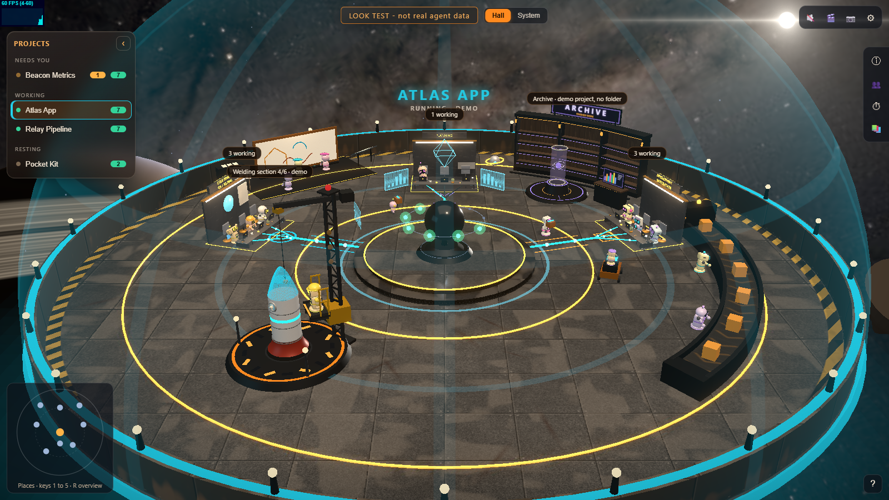
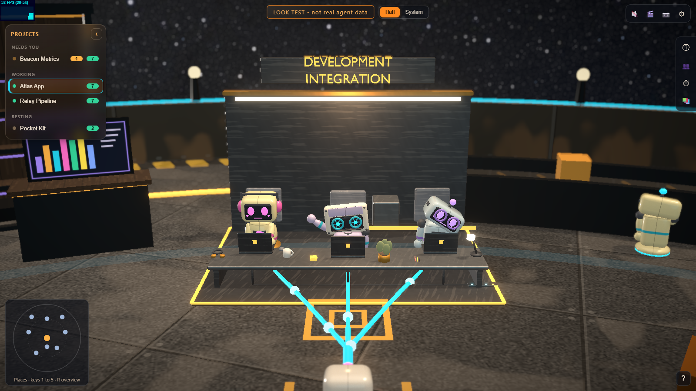
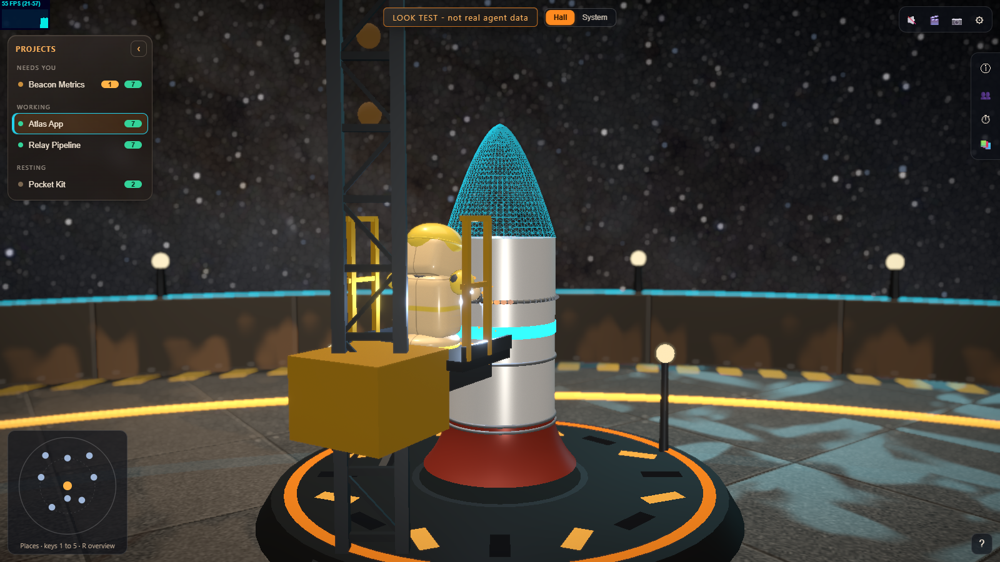
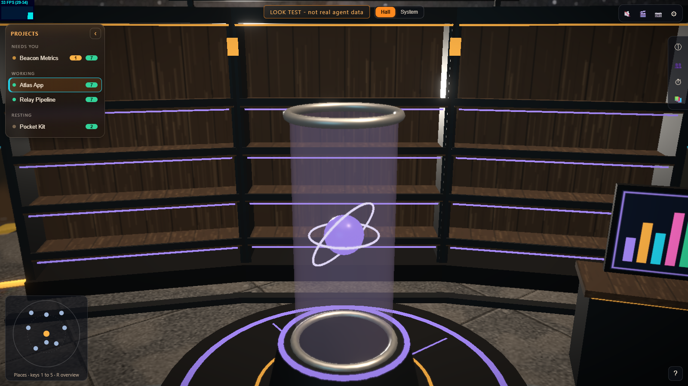
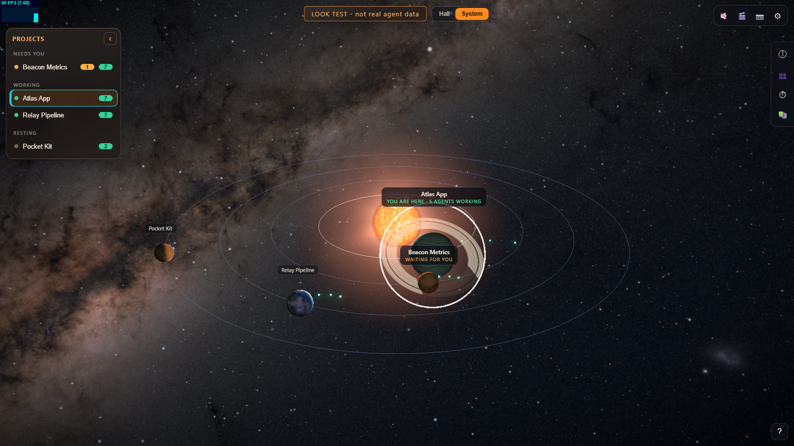

# agent-factory-3d

**See your real AI coding agents at work, as robots in a 3D factory.**

A local dashboard that watches the coding agents on your computer (Claude Code, Codex, GitHub Copilot, or anything that
can run a command) and shows each one as a robot in a round command hub. Working agents sit at their desks under a light,
an agent that waits for you waves in amber, and the ones that are idle sleep in glass pods. Zoom out and every project is
a planet in a small solar system.

It only **watches**. It never starts, stops or prompts an agent, and it never reads your messages.



> The pictures on this page use the built-in **demo data**, which the page labels "LOOK TEST - not real agent data".
> With the service running, the same page shows your real agents and says LIVE.

| | |
|---|---|
|  |  |
|  |  |

## What you get

- **The hall.** Three bays (Planning, Development & Integration, Review & QA) round a glass core. One robot per agent; its
  state is inferred from what it just did, and the page says it is inferred.
- **Active now.** A strip listing the real agents that work or wait for you. Click one for its details.
- **Rest pods.** Agents that are asleep or standing by rest in glass pods; the frost on the glass is the real time since the
  agent's last activity.
- **The library.** Your project's markdown files as books on shelves. Click one to open it in VS Code.
- **The solar system.** Press `G`. Every project is a planet; moons are working agents (coral diamond for Claude Code, blue
  cube for Codex, violet ring for Copilot); click a planet to look closer.
- **Settings, sound, a camera tour, three space themes, five quality levels** (it runs on a laptop without a graphics card).

## Quick start

You need **Node 22.15 or newer** and a browser with WebGL2.

```bash
git clone https://github.com/viraj2121/agent-factory-3d.git
cd agent-factory-3d
npm start            # installs on the first run, then starts everything
# open http://localhost:5173
```

`npm start -- --open` also opens the page. On Windows you can double-click `start-factory.bat` instead.

If the service finds no agent activity, the page shows labelled demo projects. Start any agent on your computer and the
page flips to LIVE by itself.

More: [getting started](docs/getting-started.md), [keys and guides](docs/guides), [troubleshooting](docs/guides/troubleshooting.md).

## How it works

```
Claude Code transcripts ─┐
Codex (sqlite + rollouts) ├─> agent service (Node, port 4317, read-only) ──> dashboard (React + three.js, port 5173)
Copilot Chat sessions    ─┤
POST /api/hook (any tool)─┘
```

- `apps/agent-service`: a Node 22 service with no runtime dependencies. It reads the files the tools already write,
  works out each agent's state, and serves a snapshot and a live event stream.
- `apps/dashboard`: Vite, React 19, TypeScript, React Three Fiber and drei. The 3D scene only displays state.
- `assets`: the Blender scripts that build the models (everything is made for this project).

See [architecture](docs/architecture.md) and the [data model](docs/reference/data-model.md).

## Privacy and rules

- The service binds to `127.0.0.1` and checks `Host` and `Origin`. Nothing leaves your computer.
- It reads names, tool names, counts and times. **Message text, tool inputs and results are never read or sent.**
- **Never fake results.** If something cannot be known (for example the plan progress of an agent that wrote no plan), the
  page says "unknown". Demo and decoration (the belt, the drone, the weather) are labelled as such.
- Starting, stopping and prompting agents is marked `control: unsupported`.

Details: [privacy and rules](docs/privacy-and-rules.md).

## Honest limits

- The Codex and Copilot readers depend on the file formats those tools write today and may break when the tools change.
- A state such as "asleep" or "waiting for you" is an inference from activity, not a report from the agent.
- The 3D hall needs a reasonable graphics card for the High level; use Auto or Balanced on a weaker one.

## Develop

```bash
npm run install:all   # both apps
npm test              # service and dashboard tests
npm run typecheck
npm run smoke         # real-browser check of the main paths (needs Playwright once)
```

## Credits

The star background is made from NASA's "Deep Star Maps 2020"; see [ATTRIBUTIONS.md](ATTRIBUTIONS.md). The 3D models are
built from scripts in `assets/source`. MIT licensed, see [LICENSE](LICENSE).
