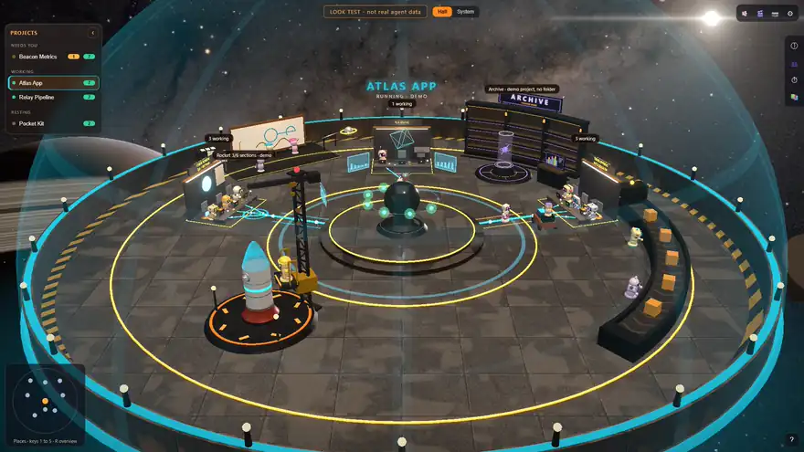
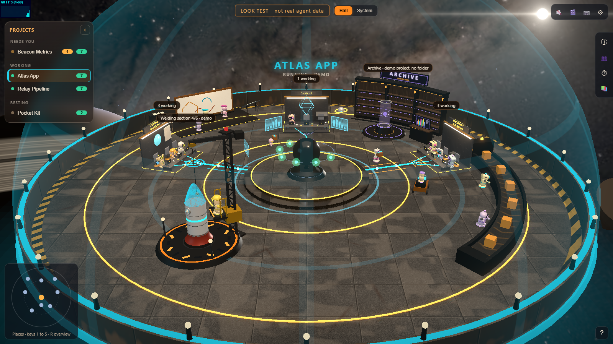
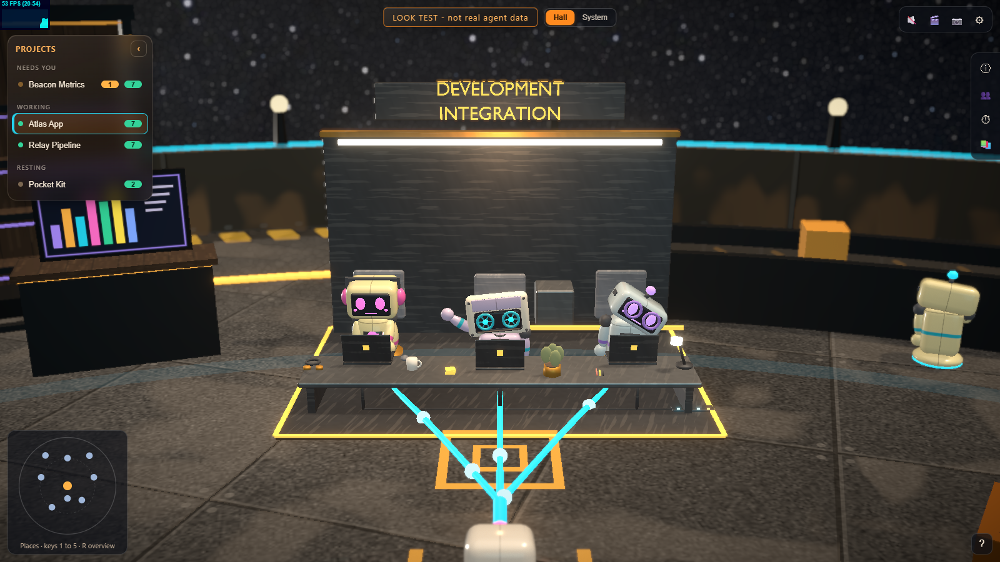
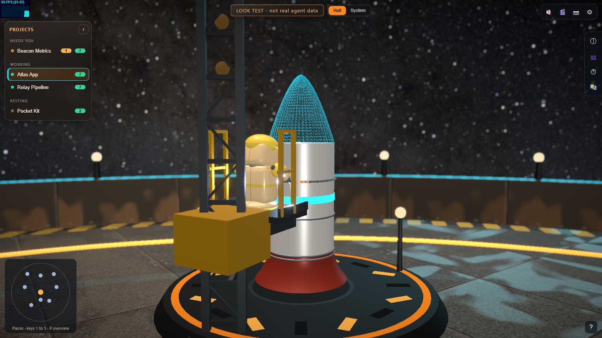
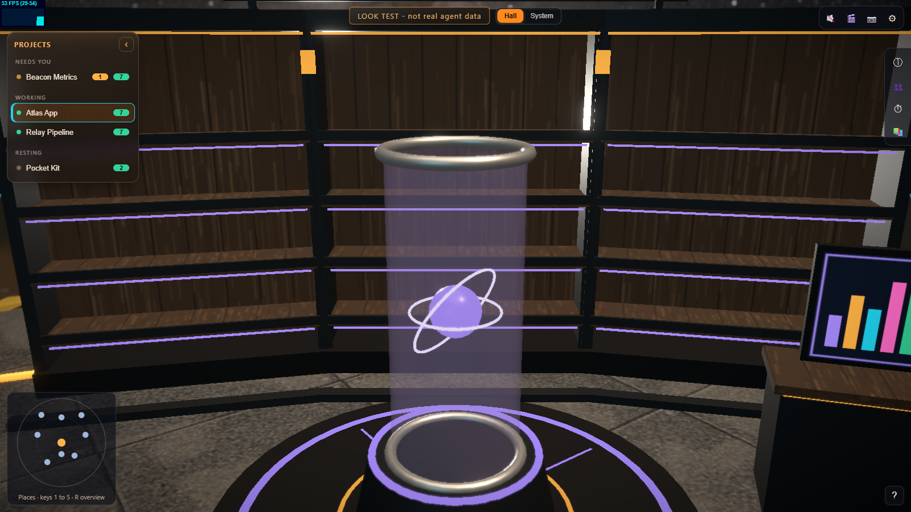
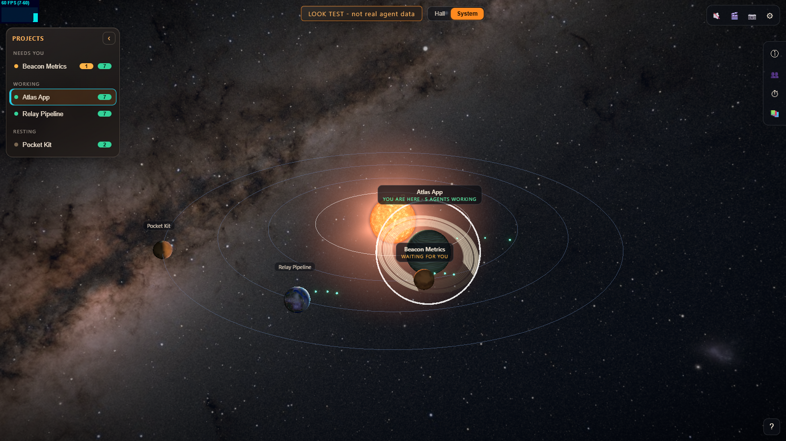

# agent-factory-3d

**See your real AI coding agents at work, as robots in a 3D factory.**

A local dashboard that watches the coding agents on your computer (Claude Code, Codex, GitHub Copilot, or anything that
can run a command) and shows each one as a robot in a round command hub. Working agents sit at their desks under a light,
an agent that waits for you waves in amber, and the ones that are idle sleep in glass pods. Zoom out and every project is
a planet in a small solar system.

It only **watches**. It never starts, stops or prompts an agent, and it never reads your messages.

[](https://github.com/viraj2121/agent-factory-3d/releases/download/v0.1.0/agent-factory-3d-trailer.mp4)

**[Watch the 50-second trailer](https://github.com/viraj2121/agent-factory-3d/releases/download/v0.1.0/agent-factory-3d-trailer.mp4)** (with narration; click the picture above too).



> The pictures on this page use the built-in **demo data**, which the page labels "LOOK TEST - not real agent data".
> With the service running, the same page shows your real agents and says LIVE.

| | |
|---|---|
|  |  |
|  |  |

## What you get

- **The hall.** Three bays (Planning, Development & Integration, Review & QA) round a glass core. One robot per agent; its
  state is inferred from what it just did, and the page says it is inferred.
- **Active now.** A strip listing the real agents that work or wait for you. Click one for its details.
- **Rest pods.** Agents that are asleep or standing by rest in glass pods; the frost on the glass is the real time since the
  agent's last activity.
- **The library.** Your project's markdown files as books on shelves. Click one to open it in VS Code.
- **The solar system.** Press `G`. Every project is a planet; moons are working agents (coral diamond for Claude Code, blue
  cube for Codex, violet ring for Copilot); click a planet to look closer.
- **Settings, sound, a camera tour, three space themes, five quality levels** (it runs on a laptop without a graphics card).

## Quick start

You need **Node 22.18 or newer** and a browser with WebGL2.

```bash
git clone https://github.com/viraj2121/agent-factory-3d.git
cd agent-factory-3d
npm start            # installs on the first run, then starts everything
# open http://localhost:5173
```

`npm start -- --open` also opens the page. On Windows you can double-click `start-factory.bat` instead.

If the service finds no agent activity, the page shows labelled demo projects. Start any agent on your computer and the
page flips to LIVE by itself.

More: [getting started](docs/getting-started.md), [keys and guides](docs/guides), [troubleshooting](docs/guides/troubleshooting.md).

## Desktop widget (Windows)

A small window that stays on top of your other windows and lists every agent session on this computer: who is waiting
for you, who is working, who is resting. At the top is the **Orbit**: you are the light in the middle and every agent
circles you. Agents that wait for you sit closest and pull in further the longer they wait; working agents circle fast
with a trail; resting ones drift at the edge. Colour shows the tool. Click a light or a row to see its details in place.

- **Start:** double-click `start-widget.cmd`. It starts the service and the dashboard in the background (no windows, logs in
  `%LOCALAPPDATA%\agent-factory-3d\logs`) and opens the widget at the top right of the screen.
- **📌** keeps it on top of other windows, or not.
- **◐ Fade:** left alone for 8 seconds, the widget fades to about a third. It turns solid when your mouse comes back or when
  an agent starts waiting for you. Click ◐ to keep it solid.
- **⇥ Dock** (or minimize the widget): the widget tucks away and a small tab appears on the right edge of the screen, half
  way down, with a tiny orbit and the waiting and working counts (an amber edge when someone waits). It is a little see-through
  and solid under the mouse. Click the tab to bring the widget back, or its small **✕** to quit everything (the widget, the
  service and the dashboard). The tab is drawn by Windows itself through PowerShell (WPF); nothing is installed.
- **Stop:** double-click `stop-widget.cmd` (closes the widget, the tab, the service and the dashboard).
- It uses Microsoft Edge in app mode as a guest (no account, nothing kept) and PowerShell for pinning, fading and the tab. If
  your computer blocks PowerShell scripts, the widget still opens, just without those parts. `check-setup.cmd` tells you which.
- The widget shows live data only. With the service off it says so; it never shows demo data.

## Set up on a new computer (Windows, step by step)

No admin rights are needed.

1. Install **Node.js 22.18 or newer** from [nodejs.org](https://nodejs.org) (the per-user installer or the zip is fine).
2. Get the code: `git clone https://github.com/viraj2121/agent-factory-3d.git` (or download the ZIP from GitHub and unzip it).
3. Double-click **`check-setup.cmd`**. It checks Node, npm, the two ports, which agent tools it can see, and whether the
   widget can pin, fade and dock on this computer. It only reads; it changes and installs nothing.
4. Double-click **`start-widget.cmd`** for the desktop widget, or **`start-factory.bat`** for the 3D hall. The first run
   installs the packages from the npm registry (behind a company proxy, first run
   `npm config set proxy http://your-proxy:port` and `npm config set https-proxy http://your-proxy:port`).
5. Use your agents as usual (Claude Code, GitHub Copilot Chat in VS Code, Codex). They show up within a few seconds.

Tip: right-click `start-widget.cmd` > Show more options > Send to > Desktop (create shortcut) to start it from the desktop.

## Will it work with my setup?

Short answer: yes for **GitHub Copilot Chat in VS Code** and **Claude Code** on Windows, macOS and Linux, if they run on the same computer as this dashboard. It reads the files those tools already write; it does not need an account, a login or any change to them.

| Tool | Where it reads (read-only) | Notes |
|---|---|---|
| Claude Code (terminal or VS Code extension) | `~/.claude/projects` | Sessions and helper agents. Agent files from `.claude/agents` and `~/.claude/agents`. |
| GitHub Copilot Chat in **VS Code** | `<VS Code user folder>/workspaceStorage/*/chatSessions` (Windows: `%APPDATA%\Code\User`) | Chat and agent-mode sessions, `.github/copilot-instructions.md`, `.github/agents`, MCP config. |
| Codex | `~/.codex` | Sessions and subagent threads. |
| Anything else | `POST /api/hook` | Any tool that can run a command can report; see `apps/agent-service/README.md`. |

**Not supported yet** (it will simply not see these, and nothing breaks):
- VS Code Insiders, VSCodium, Cursor or a VS Code with a custom user-data folder (only the standard stable VS Code folder is read).
- VS Code **Remote** sessions (WSL, SSH, Dev Containers, Codespaces): their chat files live on the remote machine, not on the one running the dashboard.
- Copilot in Visual Studio or JetBrains, and the Copilot CLI.
- A relocated Claude folder (`CLAUDE_CONFIG_DIR`).

**On a work PC:**
- You do not need admin rights. You need **Node 22.18 or newer** (a portable or per-user install is fine) and npm access to the public registry; behind a company proxy, set `npm config set proxy` / `https-proxy` first.
- Ports **4317** (service) and **5173** (dashboard) must be free on `localhost`. Nothing is exposed to the network: the service binds to `127.0.0.1` only and rejects other websites.
- By default it shows agent activity from the **last 7 days** (`AGENT_SERVICE_DAYS`, up to 365). A project appears once an agent worked in its folder.
- It reads titles, tool names, counts and times. Message text, tool inputs and results are never read. Check your company's policy before running tools that read other tools' files; the source is small and meant to be read.
- If the banner says `LOOK TEST`, the service is not running or found no activity; see [troubleshooting](docs/guides/troubleshooting.md).

## How it works

```
Claude Code transcripts ─┐
Codex (sqlite + rollouts) ├─> agent service (Node, port 4317, read-only) ──> dashboard (React + three.js, port 5173)
Copilot Chat sessions    ─┤
POST /api/hook (any tool)─┘
```

- `apps/agent-service`: a Node 22 service with no runtime dependencies. It reads the files the tools already write,
  works out each agent's state, and serves a snapshot and a live event stream.
- `apps/dashboard`: Vite, React 19, TypeScript, React Three Fiber and drei. The 3D scene only displays state.
- `assets`: the Blender scripts that build the models (everything is made for this project).

See [architecture](docs/architecture.md) and the [data model](docs/reference/data-model.md).

## Privacy and rules

- The service binds to `127.0.0.1` and checks `Host` and `Origin`. Nothing leaves your computer.
- It reads names, tool names, counts and times. **Message text, tool inputs and results are never read or sent.**
- **Never fake results.** If something cannot be known (for example the plan progress of an agent that wrote no plan), the
  page says "unknown". Demo and decoration (the belt, the drone, the weather) are labelled as such.
- Starting, stopping and prompting agents is marked `control: unsupported`.

Details: [privacy and rules](docs/privacy-and-rules.md).

## Honest limits

- The Codex and Copilot readers depend on the file formats those tools write today and may break when the tools change.
- A state such as "asleep" or "waiting for you" is an inference from activity, not a report from the agent.
- The 3D hall needs a reasonable graphics card for the High level; use Auto or Balanced on a weaker one.

## Develop

```bash
npm run install:all   # both apps
npm test              # service and dashboard tests
npm run typecheck
npm run smoke         # real-browser check of the main paths (needs Playwright once)
```

**Working on this repo with an AI coding agent** (GitHub Copilot, Codex, Claude Code): [AGENTS.md](AGENTS.md) explains the
layout, the commands, the rules (read-only, never fake data, localhost only) and how to check a change.
GitHub Copilot reads it through [.github/copilot-instructions.md](.github/copilot-instructions.md).

## Credits

The star background is made from NASA's "Deep Star Maps 2020"; see [ATTRIBUTIONS.md](ATTRIBUTIONS.md). The 3D models are
built from scripts in `assets/source`. MIT licensed, see [LICENSE](LICENSE).
